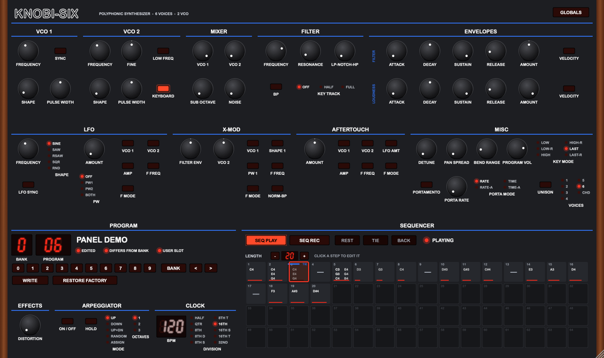

# KNOBI-SIX plugin (AU / VST3)

KNOBI-SIX as an instrument plugin for Ableton Live 12 on a Mac (Apple Silicon): the firmware's own synth, arp, clock and
sequencer (`firmware/src/core/knobi_core.h`) inside a [JUCE](https://juce.com) 8 plugin. Design:
`docs/superpowers/specs/2026-11-19-plugin-design.md`; plan: `docs/superpowers/plans/2026-11-19-plugin.md`.

What it is: the firmware's synth (6 voices, the OB-6-style voice and effects), arp, clock and 64-step sequencer, as an
instrument plugin. 73 sound parameters are Live parameters (automatable, MIDI-mappable); the 500-program bank is shared
by every instance through one library file; the arp and the sequencer follow Live's transport; the window is the
OB-6-style panel with the sequencer grid.

Contents: [Build](#build) · [Install](#install-for-live-12) · [Loading in Live 12](#loading-in-live-12) ·
[The panel](#the-panel) · [The program bank](#the-program-bank-and-the-library-file) · [Clock with Live](#clock-with-live) ·
[Sequencer](#sequencer) · [Known limits](#known-limits) · [auval](#auval) · [How it works](#how-it-works) ·
[Checklist for Live](../docs/PLUGIN_CHECKLIST.md)

> **AU recommended in Live.** The VST3 works, but JUCE's VST3 wrapper reports program loads and CC changes to Live in
> a way Live may record as automation (or that switches a parameter's automation off), and it cannot tell Live that
> program names changed (see [Known limits](#known-limits)). The AU has neither problem.

## Build

```sh
brew install cmake ninja                       # once (Xcode 26.6 / its command-line tools for the compiler)
cmake -S plugin -B build/plugin -G Ninja -DCMAKE_BUILD_TYPE=Release
cmake --build build/plugin
ctest --test-dir build/plugin --output-on-failure
```

The first configure downloads JUCE 8.0.15 (pinned by commit and SHA-256 in `plugin/CMakeLists.txt`, ~23 MB). The
bundles land in `build/plugin/KnobiSix_artefacts/Release/AU/KNOBI-SIX.component` and `.../VST3/KNOBI-SIX.vst3`, ad-hoc
signed (`codesign -dv` says `Signature=adhoc`). A build installs nothing.

### With the OB-6 factory bank (local only)

`-DKNOBI_FACTORY_LOCAL=ON` compiles your local `firmware/gen/factory_bank.h` (made by `tools/ob6_import.py`, never
committed; `docs/FACTORY_BANK.md`) into the plugin. That build is named **KNOBI-SIX-local** everywhere (bundle files,
plugin name, AU code `aumu Kn6l Jhrt`, bundle id `com.jhortale.knobisix.local`), so it never stands in for the
default build and both can be installed side by side. Never share it; CI never builds it. Use a separate build
directory:

```sh
cmake -S plugin -B build/plugin-local -G Ninja -DCMAKE_BUILD_TYPE=Release -DKNOBI_FACTORY_LOCAL=ON
cmake --build build/plugin-local
```

The factory programs are the bank's programs wherever the library has no WRITE of its own (the program list, MIDI
program change, RESTORE FACTORY).

## Identity

| | default | `KNOBI_FACTORY_LOCAL=ON` |
| --- | --- | --- |
| name | KNOBI-SIX | KNOBI-SIX-local |
| AU type / subtype / manufacturer | `aumu` `Kn6x` `Jhrt` | `aumu` `Kn6l` `Jhrt` |
| bundle id | `com.jhortale.knobisix` | `com.jhortale.knobisix.local` |
| VST3 category | Instrument / Synth | Instrument / Synth |

The codes follow Apple's rules (manufacturer: at least one capital; subtype: exactly one capital) and stay fixed:
Live finds a plugin in a saved set by them.

## Install (for Live 12)

Copy the bundles into your user plug-in folders and let Live rescan:

```sh
ditto build/plugin/KnobiSix_artefacts/Release/AU/KNOBI-SIX.component ~/Library/Audio/Plug-Ins/Components/KNOBI-SIX.component
ditto build/plugin/KnobiSix_artefacts/Release/VST3/KNOBI-SIX.vst3 ~/Library/Audio/Plug-Ins/VST3/KNOBI-SIX.vst3
killall -9 AudioComponentRegistrar 2>/dev/null; auval -v aumu Kn6x Jhrt | tail -3   # the AU registered and valid
```

To update, copy again (quit Live first, or rescan). To remove both:

```sh
rm -rf ~/Library/Audio/Plug-Ins/Components/KNOBI-SIX.component ~/Library/Audio/Plug-Ins/VST3/KNOBI-SIX.vst3
killall -9 AudioComponentRegistrar 2>/dev/null
```

(The local build's bundles are `KNOBI-SIX-local.component` / `.vst3`, removed the same way.)

In Live 12: Settings → Plug-Ins → turn on "Use Audio Units v2" and "Use VST3 Plug-in System Folders" (or "Custom
Folder" pointing at `~/Library/Audio/Plug-Ins/VST3`), then **Rescan** (hold Option while clicking it for a full
rescan). KNOBI-SIX appears in the browser under Plug-Ins → Audio Units → jhortale and VST3 → jhortale.

## Loading in Live 12

Drop KNOBI-SIX on a MIDI track (Plug-Ins -> Audio Units -> jhortale, or VST3 -> jhortale); its window opens: the panel.
**Use the AU**: the VST3 wrapper's program-load / CC reporting and program names are the known problems (see Known limits). Live compensates the plugin's latency: 256 samples at 44.1 kHz, 332 at
48 kHz, 610 at 88.2, 664 at 96 (5.8 ms at 44.1 kHz, 6.9 ms at the others; the device's context menu shows it as
"Delay Compensation"). The device's parameter list (Configure, or the automation lane chooser) shows the 73
parameters by the firmware's names; the program menu lists the bank's 500 programs (`000 INIT` ... in the default
build); the instance's sound (program number, values, sequence, edited flag) is saved with the set. Automation is
applied at the first sample of the host block that delivers it; MIDI is sample-accurate.

What to try, step by step, and what to look for: **[docs/PLUGIN_CHECKLIST.md](../docs/PLUGIN_CHECKLIST.md)** (not
automated: it needs Live; nothing in it has been done yet).

## The panel



(`docs/panel-100.png`, `docs/panel-200.png`, `docs/panel-globals.png`, `docs/panel-seqstep.png` — the STEP editor:
rendered by the `panel_screenshots` test, a synthetic demo sequence in the grid;
`build/plugin/tests/test_editor panel_screenshots plugin/docs`.) After the approved mockups
(`docs/design/standalone-ui/panel-style-v2.html`, `sections-v2.html`): every section at once, in the panel's order —
VCO 1, VCO 2, MIXER, FILTER, ENVELOPES; LFO, X-MOD, AFTERTOUCH, MISC; PROGRAM, EFFECTS (distortion), ARPEGGIATOR,
CLOCK; SEQUENCER. Every Live parameter has exactly one control: knobs (drag up / down or sideways, double-click: the
default; the value shows while dragging), red pads for switches (lit = on), red LED lists for choices (click one), the
BPM on a red display (drag up / down).

- **Size**: drag the window's corner: 100 % (1280 × 760, fits a 1440-wide screen) to 200 %, the layout scaled as a whole.
  The instance remembers the size while it is loaded.
- **PROGRAM**, as the keyboard: two digit pads = tens then ones in the bank shown; BANK then 0–4 = the same number in
  that bank; `<` `>` step. Loading a program drops the edit buffer (as on the keyboard: WRITE first). Lights: EDITED
  (changed since loaded), DIFFERS FROM BANK (not what the bank holds for this number — an edit, an older set's copy, or
  another instance's WRITE since), USER SLOT (the slot holds a WRITE; else the factory program).
- **WRITE**: press WRITE (lit, the number blinks), choose the slot with BANK / digits / `<` `>` (nothing loads), press
  WRITE again; CANCEL leaves. The message line says what happened: "PROGRAM 045 STORED"; "STORED IN 045; THE INSTANCE
  MOVED ON TO PROGRAM 7" (a program change arrived while the file was written: the slot has what you wrote, the
  instance plays the newer load); "LIBRARY FROM A NEWER VERSION - NOT WRITTEN"; "WRITE FAILED - NOTHING CHANGED".
  If the library file could not be read (a red notice at the top), the first WRITE asks first: the unreadable file is
  kept as `library.knobi.bad-<date-time>` beside it, then a new library is written.
- **RESTORE FACTORY**: the factory program of the number in play into the edit buffer (edited); nothing is stored
  until WRITE (which then empties the slot: the factory program again).
- **CLOCK**: the BPM display shows the program's BPM; greyed, showing Live's tempo, while Live plays (the clock follows
  Live). DIVISION: the step length of the arp and the sequencer.
- **SEQUENCER**: SEQ PLAY (lit when on) and the state: OFF, WAITING FOR LIVE (on, Live stopped: it starts on Live's
  play), PLAYING, RECORDING.
  - **The grid** (64 steps, 16 a row): LENGTH, each step's notes by name (middle C = 60 = **C4**, the firmware's names;
    Live calls it C3), a velocity bar, a rest as a dash, a tie as "TIE" with a blue bar to the step before, steps past
    the length as empty frames, the step playing framed red. **Click a step** to open its STEP editor: a two-octave
    piano (`<` `>` an octave; notes C0–C8, 12–108) — click a key to add the note, a lit key to remove it (6 notes at
    most); each note's velocity bar (drag it; sent when you let go) and X; REST; TIE (ties it to the step before: it
    then carries a copy of that step's notes and follows them; refused on step 1 and after a rest, the reason shown in
    red; TIE again unties it; a tied step's velocities are its chain's first step's); `<` `>` the step before / after; CLOSE. LENGTH: `-` `+` or drag the number (1–64; new
    steps are rests). A change is an edit of the program, as on the keyboard: EDITED lights, WRITE stores it with the
    program, a program change loses it. While the sequence plays, an edit is heard from the next step.
  - **SEQ REC** (step entry, the keyboard's rules, `docs/CONTROLS.md` "Recording"): click it, then play notes in Live
    (a clip, a MIDI keyboard into the track): a note = a step at its velocity; a chord = keep a key held while adding
    notes; **REST** = a rest (let go of the keys first); **TIE** with keys held = they are recorded and held on one more
    step (again: one more), with none held = the last step held on (not on step 1, not after a rest); **BACK** erases
    the last step. The sequence is replaced at the first entry (ending with none leaves it as it was); recording stops
    by itself at 64 steps; SEQ REC again, SEQ PLAY, a program change end it. The grid shows the steps as they come and
    is read-only meanwhile. Notes from the **computer keyboard**: turn on Live's Computer MIDI Keyboard (press `M` in
    Live, the track armed or monitored): its notes reach KNOBI-SIX as Live MIDI and are recorded like any other.
  - **To empty a sequence** (the grid's LENGTH is 1–64): SEQ REC, one entry (a note or REST), BACK, SEQ REC — the
    sequence is then empty (length 0). There is **no undo** for grid edits: a program change (or loading the program
    again) drops them, WRITE keeps them.
  - **Transpose**: while the sequence plays, **hold SEQ REC** (mouse button down) and play a note in Live: the sequence
    is transposed by the note minus C4 (60), from the next step; that note is neither played nor recorded; let go: it
    stays (XP shows it on the grid). A click without a note while it plays stops the sequence and starts recording, as
    the keyboard's button. The keyboard's UNISON rule (keys transpose with no hold) is not applied to Live's notes (on
    the keyboard MIDI in never transposes).
- **GLOBALS** (top right): master tune (cents), transpose (semitones), velocity and aftertouch curves, stereo / mono —
  kept in the library file, so every instance follows.
- Font: the mockups' *Arial Rounded MT Bold*, a macOS system font, asked for by name at run time; nothing is embedded
  (no font file in this repository or the bundles). The red displays are drawn segment by segment.
- The panel never calls the core: it reads and writes Live's parameters and the processor's own API. It polls them on
  a 15 Hz timer of the message thread (no listener on the parameters: the AU / VST3 wrappers call parameter listeners
  on the audio thread during automation, and JUCE's attachments would post messages from there), so the audio thread
  never waits for, or allocates for, the panel (test `panel_rt`).

## The program bank and the library file

`~/Music/KNOBI-SIX/library.knobi` holds what you WRITE: each of the 500 slots is empty (the factory program of this
build: INIT in the default build) or a full program + sequence in the keyboard's own record format, plus the globals
(master tune, transpose, velocity and aftertouch curves, stereo / mono; MIDI channel is always omni in the plugin).
One file for every instance in every set: a WRITE in one instance appears in the others within a quarter of a second
(each process watches the file). The folder is made on the first WRITE; until then nothing is written anywhere.
Format and rules: `src/Library.h`.

- Two instances writing at once: both writes land (the file is re-read and written under a lock); the same slot from
  two places at once: the later one wins.
- A crash or power loss while writing leaves the previous file (temp file + rename).
- A file it cannot read (damaged, or written by a newer plugin): the factory programs, a "library unreadable" notice,
  and the file is not touched. The next WRITE keeps it first as `library.knobi.bad-<date-time>` beside it. A single
  slot it cannot use: that slot is the factory program (counted in a notice), and its data stays in the file.
- Back it up by copying the file; delete it to start again from the factory programs.
- Known limitation: after a WRITE (here or in another instance) the host's program list may show the old names
  until it asks for them again (reopen the device's program menu, or reload the set). Neither plugin format offers
  a reliable way to say "the program names changed": AU has no notification for its preset list, and in JUCE 8.0.15
  the VST3 wrapper does not pass one on for program names. The sound and the panel always use the new bank.

## Clock with Live

- While Live plays, the arp and the sequencer follow its tempo and position: step n of the DIVISION sits at position
  n x its length from the song's start, so starting mid-bar, a loop's wrap or a locate lands on the matching step. The
  panel's BPM display shows Live's tempo, greyed; P_BPM is kept but not used.
- **Live stopped**: the sequencer stops with Live. SEQ PLAY on while Live is stopped (or before it ever played)
  **arms** it ("WAITING FOR LIVE"): Live's play starts it on the song position's step. The **arp keeps running** on
  the internal clock at the program's BPM (keys held; a new arp pattern restarts it unless ARP BEAT SYNC).
- A jump or a stop releases the arp's and the sequencer's notes. The arp's pattern is not reset at a loop's wrap.
- Tempo automation is followed within one sample of the ideal grid. No MIDI clock out.
- Details and the tests: "How it works" below (`transport_*`).

## Sequencer

On the panel (the grid and the STEP editor: "The panel" above). In short:

- **Grid editing** (mouse): click a step, edit notes, velocities, REST / TIE; LENGTH 1-64. While it plays an edit is
  heard from the next step; no stuck notes.
- **Step entry** (SEQ REC): play notes in Live (a clip or a MIDI keyboard into the track); REST, TIE, BACK as on the
  keyboard. Notes from the computer keyboard: turn on **Live's Computer MIDI Keyboard** (`M` in Live, track armed or
  monitored); its notes arrive as Live MIDI and are recorded like any other.
- **Emptying**: SEQ REC, one entry, BACK, SEQ REC. **No undo** for grid edits: a program change drops them, WRITE
  keeps them.
- WRITE keeps playing (the sequence and sound go on; the mark "stored" is set, no reload). CC 123 releases the
  notes; the sequence keeps playing.

## Known limits

- **No MIDI out**: the arp's and the sequencer's notes are not sent as MIDI (the plugin makes sound only), and there
  is no MIDI clock out. To play another instrument from the sequence, there is no way yet.
- **No swap with the keyboard** yet: moving a program or sequence between the plugin and the SMK-37 is not there
  (the library uses the keyboard's own record format; a later step).
- **VST3** (JUCE 8.0.15): a program change or CC may be recorded as automation or switch a parameter's automation
  off while Live records (checklist point); program names in the host are not refreshed after a WRITE. Use the AU.
- **Program names in hosts**: after a WRITE (here or in another instance) the program list may show the old names until
  the host asks again (reopen the menu / reload the set). The sound and the panel use the new bank at once.
- **Automation per block**: a host block's automation value applies at the block's first sample (JUCE 8 hands one
  value per parameter per block), MIDI at its own sample.
- The importer's ARP HOLD is always imported off (the slot is unverified).
- The firmware's UNISON rule (keys transpose with no hold) is not applied to Live's notes.
- Apple Silicon Mac only, ad-hoc signed (Live runs it from your user folders; no notarisation).
- Not tried in a real Live yet: the checklist is João's to run.

## auval

`auval -v aumu Kn6x Jhrt` validates the installed AU (it needs the copy in `~/Library/Audio/Plug-Ins/Components`).
The auval runs in development (and CI's, on its runner) install the **default** (non-factory) AU there, never the
local one; on this Mac it is installed since Task 3 (remove it as above).
`cmake -DKNOBI_TEST_AUVAL=ON` adds it to `ctest` (CI's `plugin-macos` job installs the AU on the runner and runs it).

## How it works

- `src/CoreRunner.*`: one core instance (`kc_t`) per plugin instance. The core renders at 44.1 kHz in the firmware's
  256-frame blocks; MIDI is applied at its sample (`kc_render_exact` splits the block there), and the output is the
  core's stream delayed by a fixed latency, so it does not depend on the host's block size and sits exactly on the
  host's timeline once Live compensates the reported latency.
- `src/Resampler.*`: 44.1 kHz → the session rate, a 96-tap Kaiser-windowed sinc at exact rational times (flat to
  ~19 kHz, images and aliasing below −100 dB).
- `src/CoreAccess.h`: the threading seam. The audio thread owns the instance in `processBlock`; other threads ask for a
  call, served by the audio thread at the start of its next block (or run directly when the host is not processing).
- `src/Processor.*`: the JUCE `AudioProcessor` (stereo out, MIDI in, no MIDI out).
- `src/Params.*`: the parameters. Every id the core exposes (`kc_param_info`) is a parameter with the stable ID
  `p<id>` and the firmware's name: switches → on/off, selects → a choice (the firmware's labels), knobs → integer steps
  over the firmware's range (bipolar knobs centred). Not parameters: the stored-only effect ids, the sequence
  generation, the chord, the name. Automation reaches the core at the first sample of the block the host delivers it
  in (JUCE 8 hands a plugin one value per parameter per block). Changes the core makes itself (a MIDI CC, a program
  change, a program load, a set state) are shown in Live's parameters within ~33 ms (a 30 Hz timer on the message
  thread), with no begin / end gesture; the host's echo of such a change never pulls the core back.
- `src/ProgramBank.*`: the bank as the plugin reads it (program + sequence of any number, names for the program list,
  the factory layer alone for RESTORE FACTORY), through a private scratch core instance with the same bank, so loading
  is the firmware's own.
- `src/Library.*` (plan Task 6): the library file (format, atomic write under a lock, the watcher thread that reloads
  it) as immutable snapshots. Each processor takes every snapshot: its bank to ProgramBank and to the playing core
  (`kc_bank_set`, taken at the core's next call), its globals through `access()`. A replaced snapshot is freed only
  once `kc_bank_in_use` shows the core has moved on (`Processor::collectBanks`, from the replacing thread and the
  30 Hz timer; never the audio thread, which holds no reference). `Processor::writeProgram` (WRITE: number and content
  always agree, also while a program change waits for the engine, `kc_program_pending`), `restoreFactory`, `setGlobal`
  and the browser's bank / tens / ones are what the panel (Task 7) calls.
- The clock from Live (plan Task 5; `CoreRunner::transport`, `knobi_core.h` `kc_clock_host`, `synth/clock.h` "The
  host's transport"): each block's tempo, position (ppq), playing and loop points from the AudioPlayHead go to the
  core at the block's first sample (and a loop's wrap inside a block at its own sample). While Live plays the steps are
  Live's grid from the song's start: step n of the division at position n × its length, so starting mid-bar, a loop's
  wrap and a locate land on the matching step (the sequence plays step n modulo its length: bar 1 plays its step 1); a
  step inside its first half when you jump in plays at once with the rest of its gate, later the next step waits; a
  jump or a stop releases the arp's and the sequencer's notes; a new arp pattern (or SEQ PLAY) waits for the next step
  of Live's grid (no restart: Live owns the phase). A step at Live's position p sounds exactly where a clip
  note at p sounds (same sample, same latency compensation: `transport_aligned`). Tempo automation is followed (a ramp
  predicted within the block: within one sample of the ideal grid). P_BPM is kept but not used while Live plays
  (`Processor::followingHost()` for the panel's grey). Stopped: the firmware's clock for the arp (internal at P_BPM
  from where it was, the firmware's rules: the arp plays with keys held, a new arp pattern restarts it unless ARP BEAT
  SYNC); the sequencer stops with Live (João's decision): SEQ PLAY on while Live is stopped (or before it ever played)
  arms it (`kc_seq_state` 2, no note, no clock restart) and Live's play starts it on the song position's step. A loop's
  wrap uses the core's tempo exactly (quantised to 1/64 BPM) and a host still just before the loop's end after a
  predicted wrap counts as wrapped, so no step is doubled or skipped (`transport_loop_tempo`). The arp's pattern is not
  reset at a loop's wrap. No MIDI clock out. A host that gives no position (no play head, or no ppq) gives the clock
  nothing: the firmware's clock as on the keyboard (SEQ PLAY plays at once, never armed; `transport_none`). A host
  that stops giving a position while playing is taken as stopped once (notes released, the sequencer armed), then the
  clock is internal (`transport_vanishes`).
- `src/StateCodec.*`: the set state: `KN6S`, version, minimum reader version, then tagged records (program number,
  flags, the firmware's packed program record, its packed sequence record); unknown records are skipped, older program
  record versions load. The stored copy wins over the bank on load. If the instance does not answer when Live saves
  (the call timed out), the last state saved or loaded is saved again as it was, never INIT.
- `tests/`: CTest, one test a name (the list with what each checks: the head of `tests/test_plugin.cpp` and of
  `tests/test_editor.cpp`). The groups:
  - rendering (`render_44k_bitexact`, `render_48k`, `midi_sample_accurate`, `events_ordered`);
  - real time (`rt_no_alloc`: an allocation and lock counter around `processBlock`; `rt_params`);
  - the threading seam (`seam`, `seam_idle_clamped`, `silent_block`, `prepare_keeps_pending`,
    `prepare_takes_instance`; offline: `offline_no_silent`, `offline_run_waits`);
  - the parameters (`params_layout`, `automation_to_core`, `core_to_host`);
  - the set state (`state_*`, incl. `state_timeout_keeps_last`);
  - the clock from the host (`transport_*` with a fake AudioPlayHead, incl. `transport_none` for a host without one
    and `transport_vanishes` for one that stops giving a position; `bpm_param_greyed`);
  - the shared library (`library_*`, `reload_off_audio_thread`, every file in a temporary directory) and
    `factory_gating`;
  - the panel, `test_editor.cpp` (plan Tasks 7 and 8, made offscreen): `panel_*` (incl. `panel_idle`, `panel_rt`,
    `panel_screenshots`) and the sequencer grid `grid_*`;
  - `bundle_exports` (the bundles export none of the firmware's symbols); `auval` (with `-DKNOBI_TEST_AUVAL=ON`).
- What `rt_no_alloc` covers: `processBlock` as the tests call it — the processor, CoreRunner, the core, CoreAccess's
  audio side, the silent path and its replay (`silent_block`) — counting the malloc family (incl. typed and zone
  allocators, so `operator new`) and pthread mutexes / rwlocks / `os_unfair_lock`. Not covered: what JUCE's AU / VST3
  wrapper does around `processBlock` in a real host (its own locks), condition variables, semaphores, dispatch calls.
- A collision (rare: the host resumes while another thread runs a call it took after a real idle of 3 block periods,
  at most 500 ms -- a quarter of the call's 2 s timeout, so a host that is not processing is always found in time):
  that block fades out to silence over 64 samples, its MIDI is replayed at the start of the next block (in order;
  more than 256 messages: all notes off), the missed samples are rendered then (output dropped) so the timeline stays
  the host's, and the next block fades in over 64 samples. A note shorter than the missed block collapses to its start.
- Offline (an export or a freeze: the host's `isNonRealtime`): never a collision. A call from another thread (the
  panel's poll, a set state) is always served by the audio thread between blocks, however slow the render, and a block
  that finds the instance held (a call that started before, `prepareToPlay`) waits for it instead of being output
  silent (`offline_no_silent`, `offline_run_waits`). With no block coming while offline, a call times out after 2 s as
  with a stuck host (a set state saved then is the last good one).

## Licence

GPL-3.0-only (the repository's `LICENSE`). JUCE 8 is used under its AGPLv3 option (`LICENSING.md`).
